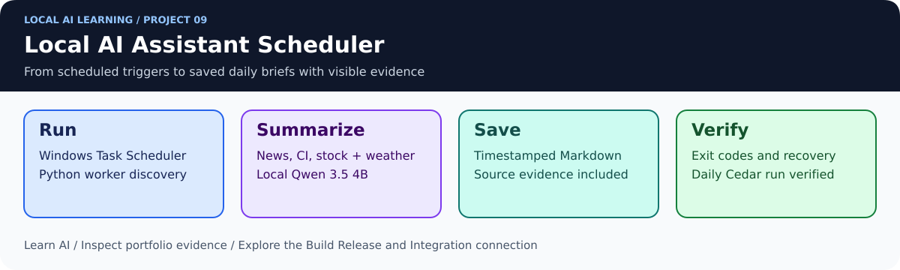
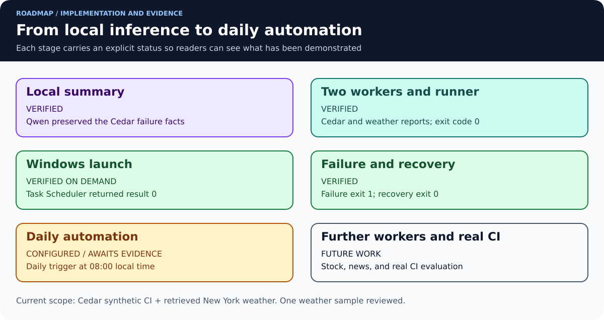
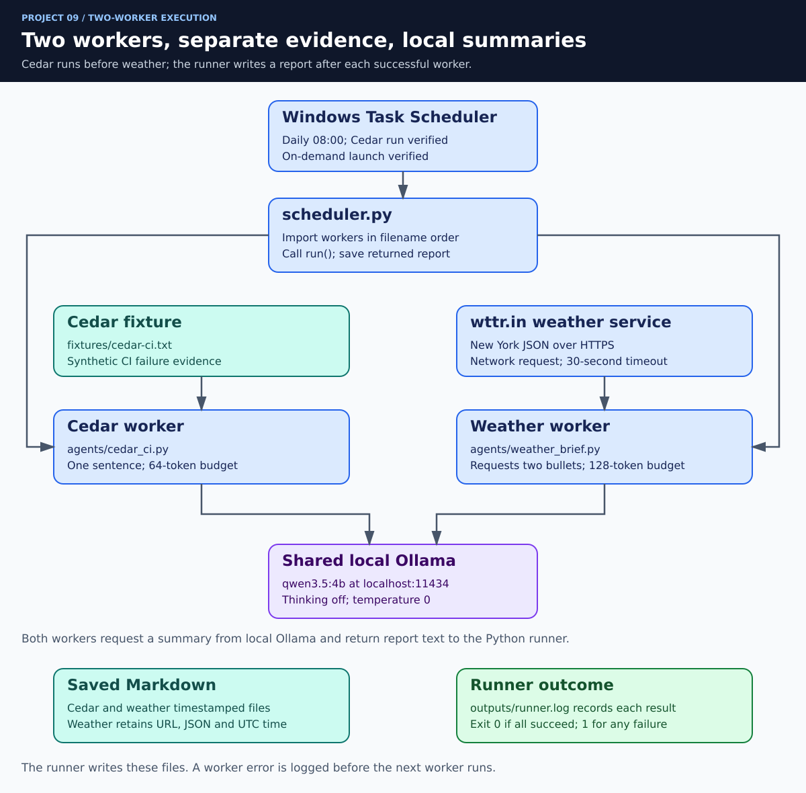
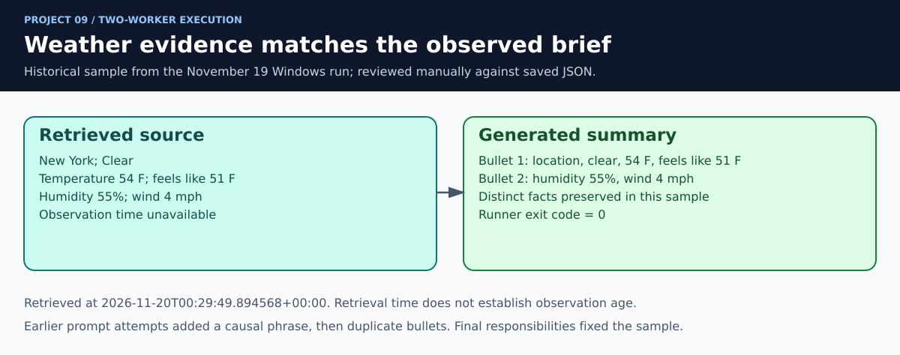

# 🗓️ Local AI Assistant Scheduler



**🟦 Learn AI · 🟩 Portfolio evidence · 🟪 PhD research**

Run local AI workers with Python, Ollama, and Windows Task Scheduler. Four workers generate briefs for AI news, synthetic Cedar CI evidence, GOOGL quotes, and New York weather. All four workers completed a Windows run with exit code 0. The stock sentence matched its saved quote values. The supplied news feed had empty excerpts; a subsequent correction labels headline-only entries and skips model generation for them.

## 🧭 Explore the project

[🟦 Base tutorial](#base-tutorial) · [🧩 Contributions](#contributions) · [🗺️ Roadmap](#roadmap) · [🧩 Architecture](#architecture) · [🚀 Setup](#setup) · [🧪 Results and verification](#verification) · [🗂️ Evidence and guides](#evidence) · [🟪 Thesis connection](#research) · [🎨 Visual standard](VISUAL_STYLE.md)

> **📚 Tutorial foundation**  
> Based on Darsh Shah's freeCodeCamp tutorial, [How to Build and Schedule Local AI Assistants for Daily Tasks](https://www.freecodecamp.org/news/how-to-build-and-schedule-local-ai-assistants-for-daily-tasks/). The contribution table records this repository's adaptations and extensions.

| 🟦 Learn AI | 🟩 Inspect engineering evidence | 🟪 Explore the research connection |
| --- | --- | --- |
| Trace a local model request from fixture to summary | Inspect worker discovery, logs, and exit codes | Explore recurring CI evidence summaries |
| Practice scheduling and failure handling | Follow the observed failure and recovery runs | Plan evaluation using real build and release evidence |

<a id="base-tutorial"></a>

## 🟦 Base tutorial

Darsh Shah's tutorial introduces a Python runner, discoverable workers, local Ollama inference, saved Markdown reports, and OS scheduling. Its example workers cover stock quotes, AI news, and weather.

This repository implements **AI News**, **Cedar CI**, **GOOGL Stock**, and **Weather Brief**. News uses a public Hugging Face RSS feed as an adaptation to the tutorial's hosted Ollama search API. It covers recent entries from one publisher. Stock uses the tutorial's Yahoo Finance chart endpoint.

<a id="contributions"></a>

## 🧩 Base tutorial vs Extensions

| Origin | Item | Scope or contribution | Verification |
| --- | --- | --- | --- |
| 🟦 Tutorial baseline | 📘 Runner pattern | Worker discovery, local inference, Markdown output, and OS scheduling, based on Darsh Shah's freeCodeCamp tutorial | [Original tutorial](https://www.freecodecamp.org/news/how-to-build-and-schedule-local-ai-assistants-for-daily-tasks/) |
| 🟦 Tutorial baseline | 🌤️ Weather worker | Implements the tutorial weather example using wttr.in and local Ollama | [Worker](agents/weather_brief.py) · [Weather verification](docs/VERIFICATION.md#weather-worker) |
| 🟦 Tutorial baseline | 📈 Stock worker | Retrieves GOOGL data and computes quote changes in Python; Windows model run and one source comparison verified | [Worker](agents/googl_stock.py) |
| 🔧 Adaptation | 📰 RSS news | Up to three Hugging Face feed entries replace hosted web search; Python retains links and publication dates | [Worker](agents/ai_news.py) |
| 🔧 Adaptation | 📄 Cedar evidence | A synthetic CI fixture and standard-library HTTP client replace the tutorial's external-data examples | [Worker](agents/cedar_ci.py) · [Fixture](fixtures/cedar-ci.txt) |
| 🔧 Adaptation | 🧠 Bounded generation | Thinking disabled, temperature 0, 64 tokens for Cedar; 128 for weather, stock, and each news entry, 180-second model HTTP timeout | [Worker settings](agents/cedar_ci.py) |
| ➕ Implemented extension | 🛡️ Observable failure handling | File logging and a failure exit code, with continuation after a worker fails | [Runner](scheduler.py) · [Observed failure and recovery](docs/VERIFICATION.md#failure-and-recovery) |
| ➕ Implemented extension | 🌤️ Weather evidence | Saved JSON, source URL, and UTC retrieval time; distinct bullet responsibilities reviewed on one sample | [Weather verification](docs/VERIFICATION.md#weather-worker) |
| ➕ Implemented extension | 📰 Headline-only boundary | Empty excerpts retain feed headlines and skip model generation; regression tested | [Verification record](docs/VERIFICATION.md#four-worker-windows-run) |
| ➕ Implemented extension | 📂 Absolute project paths | Paths resolve from Python source locations for scheduled execution | [Runner](scheduler.py) · [Windows launch evidence](docs/VERIFICATION.md#windows-launch) |
| ➕ Implemented extension | 🔎 Real CI evidence | Pinned public GitHub run/job retrieval, saved evidence, missing-data boundaries, and optional local summary; Windows metadata and Qwen runs verified | [CI extension guide](docs/GITHUB_CI_EXTENSION.md) |
| 🧭 Planned extension | 🧪 Broader CI evaluation | Representative diagnostic evidence and broader quality assessment | [Research scope](#research) |

<a id="roadmap"></a>

## 🧭 Implementation roadmap



| Stage | Status | Evidence or next action |
| --- | --- | --- |
| 🧠 Local inference | ✅ Verified | Cedar facts preserved in one-sentence output |
| ⚙️ Workers and runner | ✅ Verified | Cedar and weather reports saved; exit code `0` |
| 🌤️ Weather summary | ✅ One sample reviewed | Clear, 54°F, feels like 51°F, humidity 55%, wind 4 mph |
| 🪟 Windows task launch | ✅ Verified on demand | Fresh report and `LastTaskResult = 0` |
| 🛡️ Failure and recovery | ✅ Verified | Controlled failure returns `1`; later normal run returns `0` |
| 🗓️ Daily trigger | ✅ Configured and exercised | November 19 at 08:00:01 Windows local time |
| 🔍 Automatic Cedar execution | ✅ Verified | Task result `0` and report saved at 08:00:13 on November 19 |
| 🌤️ Automatic weather execution | ⏳ Pending verification | Weather was added after the verified morning run |
| 📈 Stock | ✅ Windows run and sample verified | Quote 272.66 USD; previous close 282.44; change -9.78; percent -3.46 |
| 📰 RSS news | ✅ Headline-only mode verified on Windows | Empty excerpts now receive an explicit headline-only label and skip model generation |
| 🔎 Real CI metadata and Qwen summary | ✅ Verified on Windows | Pinned real-run metadata and summary returned 0; reviewed against source |
| 🧪 Broader CI evaluation | 🧭 Future work | Diagnostic logs, expected outcomes, and quality assessment |

<a id="architecture"></a>

## 🧩 Architecture



The runner imports each non-private Python module in `agents/`, calls `run()`, and writes its returned text to `outputs/`. Cedar reads the fixture and asks local Ollama for one sentence. Weather retrieves New York conditions and requests two bullets covering distinct fields. Workers run sequentially in filename order: AI news, Cedar, GOOGL stock, then weather. News summarizes available feed excerpts. Entries with empty excerpts retain their original headlines and receive an explicit headline-only label without a model call. Stock computes change and percentage change in Python before asking for one descriptive sentence. The runner catches a worker exception, logs it, and proceeds to the next worker.

| Color and role | Components |
| --- | --- |
| 🔵 Processing | Task Scheduler launch, Python runner and all four workers |
| 🟣 Model | Local Ollama and `qwen3.5:4b` |
| 🟦 Storage | Fixture, generated Markdown, and log file |
| 🟢 Observable outcome | Report creation and successful exit |
| 🔴 Failure | Logged worker exception and nonzero exit |
| 🟡 Pending state | Automatic execution of the expanded four-worker set awaits evidence |

## ✨ Features

- 🧠 Local inference through Ollama at `http://127.0.0.1:11434`.
- 📂 Automatic discovery of worker modules exposing `NAME` and `run()`.
- 📝 Timestamped Markdown reports containing each summary and source evidence.
- 🌤️ Weather briefs retain source values, source URL, and UTC retrieval time.
- 📈 Stock briefs retain the quote timestamp, currency, prices, and Python-computed changes.
- 📰 RSS news briefs retain source titles, excerpts, publication dates, and links added by Python.
- 📋 Console and file logging through Python's standard library.
- 🛡️ Continuation after an individual worker fails.
- 🚦 Exit code `0` for all workers succeeding, `1` for a worker failure or no discovered workers.
- 🗓️ Windows daily scheduling with missed-run catch-up and overlapping-instance prevention configured.

<a id="setup"></a>

## 🧰 Requirements

- 🐍 Python with `venv` support.
- 🦙 Ollama running locally with `qwen3.5:4b` installed.
- 🪟 Windows and PowerShell for the demonstrated Task Scheduler setup.

The current Python implementation uses the standard library. It requires no third-party Python packages or hosted search key. Weather, stock, and RSS news retrieval require network access.

## 🚀 Setup and run

```powershell
git clone https://github.com/anne500/local-ai-assistant-scheduler.git
cd local-ai-assistant-scheduler
python -m venv .venv
ollama pull qwen3.5:4b
.\.venv\Scripts\python.exe .\scheduler.py
```

To run the Cedar worker directly:

```powershell
.\.venv\Scripts\python.exe .\agents\cedar_ci.py
```

### 🧪 Check new workers offline

```powershell
.\.venv\Scripts\python.exe -m unittest discover -s tests -v
```

Run `scheduler.py` to execute all four workers. News may make up to three sequential model calls, one for each entry with an excerpt. Empty-excerpt entries skip generation. Review generated summaries against the saved evidence.

## ⚙️ Configuration

| Setting | Current value | Location |
| --- | --- | --- |
| 🧠 Model | `qwen3.5:4b` | Cedar/weather payloads and shared new-worker helper |
| 💭 Thinking | `False` | Worker payload |
| 🎛️ Temperature | `0` | Worker payload |
| 📏 Output budget | Cedar `64`; weather, stock, each news entry `128` tokens | Worker payloads and `agents/_ollama.py` |
| 📰 News feed | Hugging Face Blog RSS, up to 3 entries | `agents/ai_news.py` |
| 📈 Stock symbol | `GOOGL` | `agents/googl_stock.py` |
| 🌐 Weather request timeout | `30` seconds | Weather worker |
| 📍 Weather location | `New York` | Weather `LOCATION` constant |
| ⏱️ Request timeout | `180` seconds | Worker HTTP call |
| 🗓️ Daily schedule | `08:00` Windows local time | Windows task registration |
| 📄 Evidence | `fixtures/cedar-ci.txt` | Local synthetic fixture |

## 💬 Example brief

**📄 Synthetic input**

> The Cedar smoke test failed because the signing certificate expired.

**🧠 Observed model output**

> The Cedar smoke test failed due to an expired signing certificate.

The saved report includes both the generated sentence and a section labeled **Source evidence (synthetic)**.

### 🌤️ Observed weather brief



> In New York, the weather is clear with a temperature of 54°F and a feels-like temperature of 51°F.
>
> The humidity is at 55% and the wind speed is 4 mph.

This historical sample was retrieved at **2026-11-20T00:29:49.894568+00:00**, during the November 19 Windows run. Its five weather values matched the saved JSON. The observation time was unavailable. [Reviewed evidence and prompt corrections](docs/VERIFICATION.md#weather-worker)

<a id="verification"></a>

## 🧪 Results and verification


| Check | Observed result |
| --- | --- |
| ✅ Local inference | Correct summary; initial successful PowerShell request reported 11.51 seconds total |
| ✅ Python worker | Saved Markdown with summary and source evidence |
| ✅ Runner | Discovered Cedar and weather, saved both reports, and returned `0` |
| ✅ Weather sample | Two distinct bullets matched all five weather values in the reviewed source |
| ✅ New-worker offline checks | All 12 tests passed on Windows in 0.008 seconds and in the authoring environment |
| ✅ Stock/RSS retrieval | Live endpoints parsed; report assembly checked with model responses stubbed |
| ✅ Real CI extension | Metadata-only and Qwen modes saved evidence and reports; both returned 0 on Windows |
| ✅ Four-worker Windows execution | All four reports saved; exit code 0 on November 19 |
| ✅ Stock sample | Summary matched the supplied values and Python-computed -3.46% change |
| ✅ Headline-only correction | Windows report retained three original headlines, missing-excerpt labels, and `headline_only` evidence scopes |
| ✅ Windows on-demand launch | Saved a fresh report and returned task result `0` |
| ✅ Failure isolation | Temporary worker raised an error; Cedar completed; runner returned `1` |
| ✅ Recovery | Later normal run saved a report and returned `0` |
| ✅ Automatic Cedar execution | November 19 at 08:00:01, task result `0`, Cedar report logged at 08:00:13 |
| ⚠️ November 20 automatic run | Started at 08:00:02; saved news and Cedar, then exited with 3221225786 (0xC000013A); windowless recovery prepared |

[Read the verification record and its evidence limits](docs/VERIFICATION.md).

## 📊 Observed local timing


| Measurement | Seconds |
| --- | ---: |
| 🟣 Model loading | 9.29 |
| 🔵 Remaining request time, calculated as total minus loading | 2.22 |
| ⏱️ Total | 11.51 |

These values describe one successful PowerShell smoke test. Remaining request time includes prompt processing and generation. The timeout and successful request used different settings, so these observations do not isolate the cause of the earlier timeout. Hardware, loading state, and model settings can change timings.

[Source data](docs/observed-timing.csv) · [Recorded smoke test](docs/VERIFICATION.md#local-inference)

## 🪟 Windows scheduling

The configured task is `Project 9 - Local AI Assistant Scheduler`. It uses the project's virtual-environment Python, an absolute script path, and the project working directory. The on-demand launch has been verified. Its daily trigger is configured at 08:00 Windows local time.

For the current interactive-account setup, keep Windows signed in, the laptop awake, and Ollama running. Configure the task action with `.venv\\Scripts\\pythonw.exe` for windowless execution. The runner always logs to `outputs/runner.log` and adds console logging when standard error is available. The task allows battery operation, enables missed-run catch-up, and ignores new invocations while an instance is running.

Inspect the local registration and latest execution:

```powershell
Get-ScheduledTaskInfo -TaskName 'Project 9 - Local AI Assistant Scheduler' |
    Select-Object LastRunTime, LastTaskResult, NextRunTime

Get-Content .\outputs\runner.log -Tail 5
```

The automatic November 19, 2026 run started at **08:00:01**, returned **`0`**, and logged the saved Cedar report at **08:00:13,663**. The report was `cedar-ci-2026-11-19_08-00-13_632505.md`. The next reported run was November 20 at 08:00. Weather was added after the verified morning run; its automatic execution awaits evidence. [Automatic-run record](docs/VERIFICATION.md#automatic-daily-run)

<a id="evidence"></a>

## 🗂️ Evidence and guides

| File or directory | Purpose |
| --- | --- |
| [⚙️ scheduler.py](scheduler.py) | Worker discovery, logging, report writing, and exit status |
| [🧠 agents/cedar_ci.py](agents/cedar_ci.py) | Local model request and synthetic CI brief |
| [🌤️ agents/weather_brief.py](agents/weather_brief.py) | Retrieved weather, two-bullet summary, and saved source JSON |
| [📈 agents/googl_stock.py](agents/googl_stock.py) | Quote retrieval and Python-computed changes |
| [📰 agents/ai_news.py](agents/ai_news.py) | Public RSS digest with source links |
| [🦙 agents/_ollama.py](agents/_ollama.py) | Shared local summarizer for stock and news, skipped by worker discovery |
| [🧪 tests/test_new_workers.py](tests/test_new_workers.py) | Offline numeric, RSS, evidence, and response checks |
| [🔎 extensions/github_ci.py](extensions/github_ci.py) | Explicitly invoked public CI evidence collection and brief |
| [🧪 tests/test_github_ci.py](tests/test_github_ci.py) | Identity, missing-evidence, pagination, model failure, and consistent snapshot checks |
| [📘 CI extension guide](docs/GITHUB_CI_EXTENSION.md) | Commands, historical source, saved snapshot, and verification sequence |
| [📄 fixtures/cedar-ci.txt](fixtures/cedar-ci.txt) | Reproducible synthetic input |
| [🧪 docs/VERIFICATION.md](docs/VERIFICATION.md) | Observed Windows runs and evidence boundaries |
| [📊 docs/observed-timing.csv](docs/observed-timing.csv) | Timing values behind the chart |
| [🎨 VISUAL_STYLE.md](VISUAL_STYLE.md) | Shared palette and presentation rules from Project 1 |
| `outputs/` | Local reports and `runner.log`; excluded from Git |

## 💾 Storage

Reports use `outputs/<worker-name>-<timestamp>.md`, with worker names `ai-news`, `cedar-ci`, `googl-stock`, and `weather-brief`. The runner appends to `outputs/runner.log`. Reports, logs, virtual environments, Python caches, and environment files are excluded by `.gitignore`.

## ⚠️ Limitations

- 📄 Cedar uses a synthetic fixture. The optional CI extension retrieves historical real-run metadata; one Windows metadata and Qwen summary case is verified.
- 🌐 Weather retrieval requires network access to wttr.in. Model inference runs locally.
- 🕰️ The reviewed weather sample lacked an observation timestamp. Retrieval time alone does not establish observation age.
- 🧠 Generated output receives empty/truncation checks. Factual support and bullet separation were manually reviewed on supplied examples. The code does not automatically check each fact or detect duplicate bullets.
- 🧪 The recorded runs establish local execution and failure handling. Broader accuracy and performance evaluation remains future work.
- 🗓️ One automatic Cedar run is verified. Weather was added later; automatic weather execution and repeated daily reliability await evidence.
- 📈 One stock summary matched its saved values. External services can return errors or rate limits.
- 📰 The reviewed news feed supplied headlines with empty excerpts. Headline-only fallback is verified on Windows. Live excerpt-based summary quality remains unverified.
- 📰 The news digest covers one publisher's feed entries. Entries without excerpts are explicitly labeled headline-only. Publication dates and source links are retained; broader news coverage and freshness guarantees require further evaluation.
- 🧠 Generated stock and news statements require source comparison. Quote calculations and source-link assembly are performed in Python.

<a id="research"></a>

## 🔎 Optional GitHub CI extension


A separately invoked extension retrieves a pinned public run and attempt-specific jobs, records missing evidence, and saves JSON plus a Markdown brief with an evidence hash. Authoring and Windows checks used a real historical hassfest failure; both Windows metadata-only and Qwen runs returned 0. Follow the [CI extension guide](docs/GITHUB_CI_EXTENSION.md) to verify the extension independently while the automatic four-worker run awaits evidence.

## 🟪 Thesis connection

This project provides a starting point for recurring Build Release and Integration Engineering summaries. It connects a scheduled launch to explicit source evidence, a generated brief, and an observable run result.

A research extension would use representative build logs and release artifacts, retain source run identifiers, and measure factual support, missing-evidence handling, task completion, and review time. The existing synthetic demonstration establishes the local workflow used to begin that evaluation.

## 📚 Tutorial acknowledgment and attribution

We acknowledge **Darsh Shah**, author of the foundational tutorial published by **freeCodeCamp**.

**[How to Build and Schedule Local AI Assistants for Daily Tasks](https://www.freecodecamp.org/news/how-to-build-and-schedule-local-ai-assistants-for-daily-tasks/)**

| Credit | Contribution |
| --- | --- |
| 👨‍🏫 Darsh Shah | Original tutorial and learning foundation |
| 📚 freeCodeCamp | Tutorial publisher |
| 🛠️ Repository adaptations | Cedar fixture, standard-library HTTP clients, bounded generation, weather bullet responsibilities, and public RSS news |
| 🧪 Repository extensions | File logging, failure exit codes, absolute project paths, weather evidence retention, and recorded verification checks |
