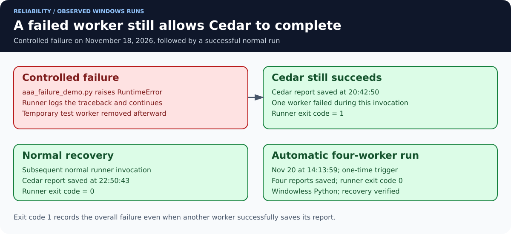
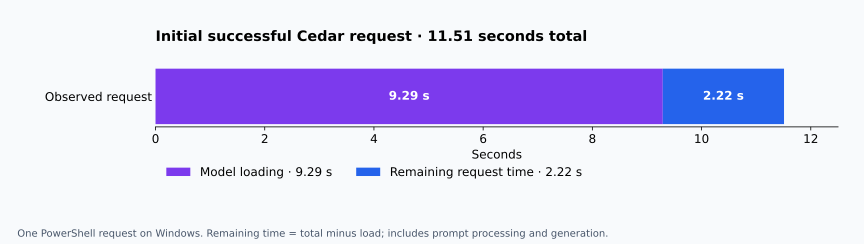

# 🗓️ Local AI Assistant Scheduler


**🟦 Learn AI · 🟩 Portfolio evidence · 🟪 PhD research**

Run local AI workers with Python, Ollama, and Windows Task Scheduler. The Cedar worker summarizes synthetic CI evidence into a timestamped Markdown brief.

## 🧭 Explore the project

[🟦 Base tutorial](#base-tutorial) · [🧩 Contributions](#contributions) · [🗺️ Roadmap](#roadmap) · [🧩 Architecture](#architecture) · [🚀 Setup](#setup) · [🧪 Results and verification](#verification) · [🗂️ Evidence and guides](#evidence) · [🟪 Thesis connection](#research) · [🎨 Visual standard](VISUAL_STYLE.md)

> **📚 Tutorial foundation**  
> Based on Darsh Shah's freeCodeCamp tutorial, [How to Build and Schedule Local AI Assistants for Daily Tasks](https://www.freecodecamp.org/news/how-to-build-and-schedule-local-ai-assistants-for-daily-tasks/). The contribution table records this repository's adaptations and extensions.

| 🟦 Learn AI | 🟩 Inspect engineering evidence | 🟪 Explore the research connection |
| --- | --- | --- |
| Trace a local model request from fixture to summary | Inspect worker discovery, logs, and exit codes | Explore recurring CI evidence summaries |
| Practice scheduling and failure handling | Follow the observed failure and recovery runs | Plan evaluation using real build and release evidence |

<a id="base-tutorial"></a>

## 🟦 Base tutorial

Darsh Shah's tutorial introduces a Python runner, discoverable workers, local Ollama inference, saved Markdown reports, and OS scheduling. Its example workers cover stock quotes, AI news, and weather.

This repository currently implements one permanent **Cedar CI worker**, using a synthetic local fixture. Stock, weather, and news workers remain future implementation work.

<a id="contributions"></a>

## 🧩 Base tutorial vs Extensions

| Origin | Item | Scope or contribution | Verification |
| --- | --- | --- | --- |
| 🟦 Tutorial baseline | 📘 Runner pattern | Worker discovery, local inference, Markdown output, and OS scheduling, based on Darsh Shah's freeCodeCamp tutorial | [Original tutorial](https://www.freecodecamp.org/news/how-to-build-and-schedule-local-ai-assistants-for-daily-tasks/) |
| 🔧 Adaptation | 📄 Cedar evidence | A synthetic CI fixture and standard-library HTTP client replace the tutorial's external-data examples | [Worker](agents/cedar_ci.py) · [Fixture](fixtures/cedar-ci.txt) |
| 🔧 Adaptation | 🧠 Bounded generation | Thinking disabled, temperature 0, 64-token limit, 180-second HTTP timeout | [Worker settings](agents/cedar_ci.py) |
| ➕ Implemented extension | 🛡️ Observable failure handling | File logging and a failure exit code, with continuation after a worker fails | [Runner](scheduler.py) · [Observed failure and recovery](docs/VERIFICATION.md#failure-and-recovery) |
| ➕ Implemented extension | 📂 Absolute project paths | Paths resolve from Python source locations for scheduled execution | [Runner](scheduler.py) · [Windows launch evidence](docs/VERIFICATION.md#windows-launch) |
| 🧭 Planned extension | 🔎 Additional workers and real CI | Further tutorial workers and evaluation with real build evidence | [Roadmap](#roadmap) |

<a id="roadmap"></a>

## 🧭 Implementation roadmap


| Stage | Status | Evidence or next action |
| --- | --- | --- |
| 🧠 Local inference | ✅ Verified | Cedar facts preserved in one-sentence output |
| ⚙️ Worker and runner | ✅ Verified | Timestamped report and exit code `0` |
| 🪟 Windows task launch | ✅ Verified on demand | Fresh report and `LastTaskResult = 0` |
| 🛡️ Failure and recovery | ✅ Verified | Controlled failure returns `1`; later normal run returns `0` |
| 🗓️ Daily trigger | 🟨 Configured | Daily at 08:00 Windows local time |
| 🔍 Automatic daily execution | ⏳ Pending verification | Inspect a subsequent automatic run and its report |
| 🌐 Further workers and real CI | 🧭 Future work | Implement and evaluate additional inputs |

<a id="architecture"></a>

## 🧩 Architecture


The runner imports each non-private Python module in `agents/`, calls `run()`, and writes its returned text to `outputs/`. Cedar reads the fixture and asks local Ollama for one sentence. The runner catches a worker exception, logs it, and proceeds to the next worker.

| Color and role | Components |
| --- | --- |
| 🔵 Processing | Task Scheduler launch, Python runner, Cedar worker |
| 🟣 Model | Local Ollama and `qwen3.5:4b` |
| 🟦 Storage | Fixture, generated Markdown, and log file |
| 🟢 Observable outcome | Report creation and successful exit |
| 🔴 Failure | Logged worker exception and nonzero exit |
| 🟡 Pending state | Automatic run awaiting evidence |

## ✨ Features

- 🧠 Local inference through Ollama at `http://127.0.0.1:11434`.
- 📂 Automatic discovery of worker modules exposing `NAME` and `run()`.
- 📝 Timestamped Markdown reports containing the summary and synthetic source evidence.
- 📋 Console and file logging through Python's standard library.
- 🛡️ Continuation after an individual worker fails.
- 🚦 Exit code `0` for all workers succeeding, `1` for a worker failure or no discovered workers.
- 🗓️ Windows daily scheduling with missed-run catch-up and overlapping-instance prevention configured.

<a id="setup"></a>

## 🧰 Requirements

- 🐍 Python with `venv` support.
- 🦙 Ollama running locally with `qwen3.5:4b` installed.
- 🪟 Windows and PowerShell for the demonstrated Task Scheduler setup.

The current Python implementation uses the standard library. It requires no third-party Python packages or hosted search key.

## 🚀 Setup and run

```powershell
git clone https://github.com/anne500/local-ai-assistant-scheduler.git
cd local-ai-assistant-scheduler
python -m venv .venv
ollama pull qwen3.5:4b
.\.venv\Scripts\python.exe .\scheduler.py
```

To run the Cedar worker directly:

```powershell
.\.venv\Scripts\python.exe .\agents\cedar_ci.py
```

## ⚙️ Configuration

| Setting | Current value | Location |
| --- | --- | --- |
| 🧠 Model | `qwen3.5:4b` | `agents/cedar_ci.py` |
| 💭 Thinking | `False` | Worker payload |
| 🎛️ Temperature | `0` | Worker payload |
| 📏 Output budget | `64` tokens | Worker payload |
| ⏱️ Request timeout | `180` seconds | Worker HTTP call |
| 🗓️ Daily schedule | `08:00` Windows local time | Windows task registration |
| 📄 Evidence | `fixtures/cedar-ci.txt` | Local synthetic fixture |

## 💬 Example brief

**📄 Synthetic input**

> The Cedar smoke test failed because the signing certificate expired.

**🧠 Observed model output**

> The Cedar smoke test failed due to an expired signing certificate.

The saved report includes both the generated sentence and a section labeled **Source evidence (synthetic)**.

<a id="verification"></a>

## 🧪 Results and verification



| Check | Observed result |
| --- | --- |
| ✅ Local inference | Correct summary; initial successful PowerShell request reported 11.51 seconds total |
| ✅ Python worker | Saved Markdown with summary and source evidence |
| ✅ Runner | Discovered Cedar and returned `0` |
| ✅ Windows on-demand launch | Saved a fresh report and returned task result `0` |
| ✅ Failure isolation | Temporary worker raised an error; Cedar completed; runner returned `1` |
| ✅ Recovery | Later normal run saved a report and returned `0` |
| 🟨 Daily trigger | Configured for 08:00 Windows local time |
| ⏳ Automatic daily execution | Pending verification |

[Read the verification record and its evidence limits](docs/VERIFICATION.md).

## 📊 Observed local timing



| Measurement | Seconds |
| --- | ---: |
| 🟣 Model loading | 9.29 |
| 🔵 Remaining request time, calculated as total minus loading | 2.22 |
| ⏱️ Total | 11.51 |

These values describe one successful PowerShell smoke test. Remaining request time includes prompt processing and generation. The timeout and successful request used different settings, so these observations do not isolate the cause of the earlier timeout. Hardware, loading state, and model settings can change timings.

[Source data](docs/observed-timing.csv) · [Recorded smoke test](docs/VERIFICATION.md#local-inference)

## 🪟 Windows scheduling

The configured task is `Project 9 - Local AI Assistant Scheduler`. It uses the project's virtual-environment Python, an absolute script path, and the project working directory. The on-demand launch has been verified. Its daily trigger is configured at 08:00 Windows local time.

For the current interactive-account setup, keep Windows signed in, the laptop awake, and Ollama running. The task allows battery operation, enables missed-run catch-up, and ignores new invocations while an instance is running.

Inspect the local registration and latest execution:

```powershell
Get-ScheduledTaskInfo -TaskName 'Project 9 - Local AI Assistant Scheduler' |
    Select-Object LastRunTime, LastTaskResult, NextRunTime

Get-Content .\outputs\runner.log -Tail 5
```

The last reported next run was November 19, 2026 at 08:00. An automatic-run result has yet to be supplied for verification.

<a id="evidence"></a>

## 🗂️ Evidence and guides

| File or directory | Purpose |
| --- | --- |
| [⚙️ scheduler.py](scheduler.py) | Worker discovery, logging, report writing, and exit status |
| [🧠 agents/cedar_ci.py](agents/cedar_ci.py) | Local model request and synthetic CI brief |
| [📄 fixtures/cedar-ci.txt](fixtures/cedar-ci.txt) | Reproducible synthetic input |
| [🧪 docs/VERIFICATION.md](docs/VERIFICATION.md) | Observed Windows runs and evidence boundaries |
| [📊 docs/observed-timing.csv](docs/observed-timing.csv) | Timing values behind the chart |
| [🎨 VISUAL_STYLE.md](VISUAL_STYLE.md) | Shared palette and presentation rules from Project 1 |
| `outputs/` | Local reports and `runner.log`; excluded from Git |

## 💾 Storage

Reports use `outputs/cedar-ci-<timestamp>.md`. The runner appends to `outputs/runner.log`. Reports, logs, virtual environments, Python caches, and environment files are excluded by `.gitignore`.

## ⚠️ Limitations

- 📄 The permanent worker uses a synthetic CI fixture. Real CI integration remains future work.
- 🧠 Generated output receives empty/truncation checks. Factual preservation in the observed Cedar run was reviewed manually.
- 🧪 The recorded runs establish local execution and failure handling. Broader accuracy and performance evaluation remains future work.
- 🗓️ Daily trigger registration is recorded; the first automatic run awaits verification.
- 🌐 The tutorial's stock, weather, and news workers remain unimplemented.

<a id="research"></a>

## 🟪 Thesis connection

This project provides a starting point for recurring Build Release and Integration Engineering summaries. It connects a scheduled launch to explicit source evidence, a generated brief, and an observable run result.

A research extension would use representative build logs and release artifacts, retain source run identifiers, and measure factual support, missing-evidence handling, task completion, and review time. The existing synthetic demonstration establishes the local workflow used to begin that evaluation.

## 📚 Tutorial acknowledgment and attribution

We acknowledge **Darsh Shah**, author of the foundational tutorial published by **freeCodeCamp**.

**[How to Build and Schedule Local AI Assistants for Daily Tasks](https://www.freecodecamp.org/news/how-to-build-and-schedule-local-ai-assistants-for-daily-tasks/)**

| Credit | Contribution |
| --- | --- |
| 👨‍🏫 Darsh Shah | Original tutorial and learning foundation |
| 📚 freeCodeCamp | Tutorial publisher |
| 🛠️ Repository adaptations | Cedar fixture, standard-library HTTP client, and bounded generation settings |
| 🧪 Repository extensions | File logging, failure exit codes, absolute project paths, and recorded failure/recovery checks |
