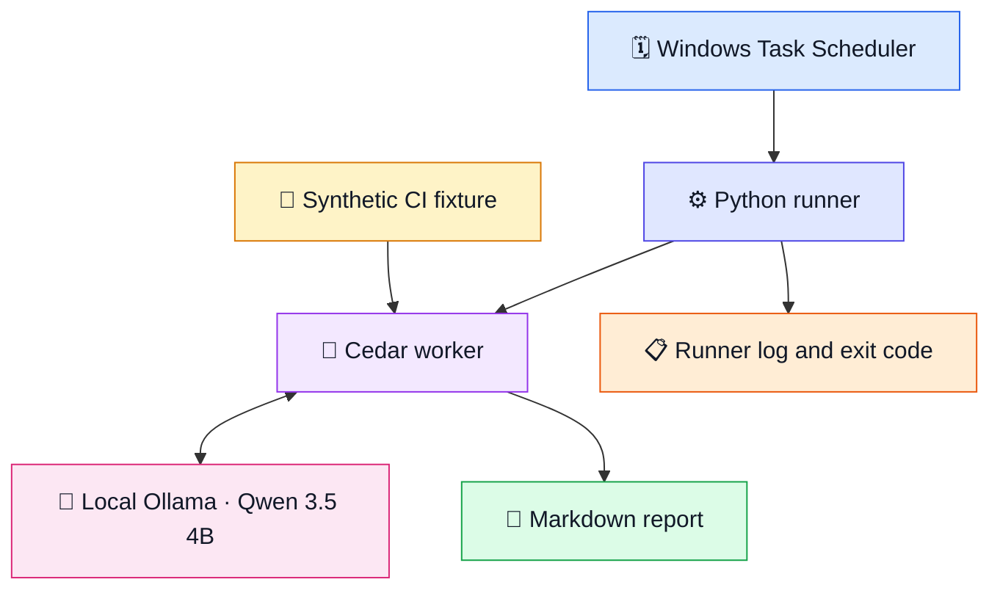

# 🗓️ Local AI Assistant Scheduler

Run local AI workers on a schedule with Python, Ollama, and Windows Task Scheduler. The first worker summarizes synthetic Cedar CI evidence and saves a Markdown report.

## 🎯 Project goals

| Focus | What this project demonstrates |
| --- | --- |
| 🟦 Learn AI | Local inference and scheduled workflows |
| 🟩 Engineering portfolio | Worker discovery, report generation, logging, and failure handling |
| 🟪 Build Release and Integration research | A starting point for recurring CI evidence summaries |

## 🏗️ Architecture



## ▶️ Run locally

Start Ollama and ensure `qwen3.5:4b` is installed.

```powershell
python -m venv .venv
.\.venv\Scripts\python.exe .\scheduler.py
```

The current implementation uses Python's standard library.

- 📂 Workers live in `agents/` and expose `NAME` and `run()`.
- 📄 Cedar reads `fixtures/cedar-ci.txt`.
- 📝 Reports and `runner.log` are written to `outputs/`.
- 🟢 Exit code `0` means all discovered workers succeeded.
- 🔴 Exit code `1` indicates a worker failure or no workers found.

## 🧪 Verified results

| Check | Observed result |
| --- | --- |
| ✅ Local inference | Correct Cedar summary, 11.51 seconds total in the initial successful PowerShell test |
| ✅ Python worker | Saved Markdown with summary and synthetic source evidence |
| ✅ Runner | Discovered Cedar and returned `0` |
| ✅ Windows on-demand launch | Saved a fresh report and returned `0` |
| ✅ Failure isolation | Controlled failing worker logged an error, Cedar still completed, runner returned `1` |
| ✅ Recovery | Subsequent normal run saved a report and returned `0` |
| 🟨 Daily trigger | Configured for 8:00 AM Windows local time |
| ⏳ Automatic daily execution | Pending verification |

Failure-test evidence was observed on November 18, 2026. The later recovery report was `cedar-ci-2026-11-18_22-50-43_830419.md`.

## 🧩 Base tutorial vs Extensions

| Layer | Implementation and status |
| --- | --- |
| 📘 Base tutorial | Folder-based workers, local Ollama inference, timestamped reports, and OS scheduling |
| 🔧 Adaptation | Standard-library HTTP client and a synthetic Cedar CI worker |
| 🔧 Adaptation | Thinking disabled and output bounded to 64 tokens |
| ➕ Extension | File logging, failure exit codes, and verified continuation after a worker failure |
| ➕ Extension | Absolute project paths for execution from another working directory |

The tutorial's stock, weather, and news workers are additional implementation work. The current project has one permanent Cedar worker.

## 🪟 Scheduling

The configured Windows task is `Project 9 - Local AI Assistant Scheduler`.

It runs daily at 8:00 AM using the project's virtual-environment Python. Settings enable missed-run catch-up, battery operation, and prevention of overlapping task instances.

For the current interactive-account configuration, keep Windows signed in, the computer awake, and Ollama running.

## 🔬 Research scope

Cedar evidence is synthetic. The successful summary demonstrates execution and preservation of the supplied facts. Evaluation with real CI runs and a broader dataset remains future work.

## 🙏 Acknowledgment

Based on Darsh Shah's freeCodeCamp tutorial, with the adaptations and extensions documented above.

[Read the original tutorial](https://www.freecodecamp.org/news/how-to-build-and-schedule-local-ai-assistants-for-daily-tasks/)
