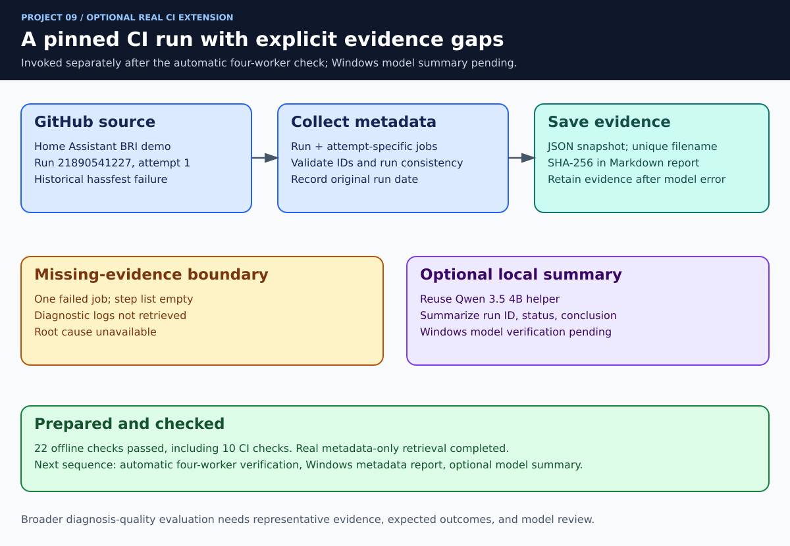

# 🔎 GitHub CI evidence extension



## 🎯 Implementation status

| Capability | Status |
| --- | --- |
| 📥 Public GitHub run and attempt-specific job retrieval | ✅ Implemented |
| 🆔 Repository, run ID, attempt, and source links | ✅ Preserved |
| 📄 JSON evidence and SHA-256 in Markdown report | ✅ Implemented |
| 🕰️ Historical run date and retrieval time | ✅ Both visible |
| 🧩 Missing jobs, steps, and diagnostic logs | ✅ Explicit evidence gaps |
| 🧪 Offline checks | ✅ All 24 tests passed on Windows in 0.300 seconds, including 10 CI checks |
| 🔎 Pinned real-run metadata mode | ✅ Completed in authoring environment and on Windows |
| 🧠 Windows local-model summary | ✅ Completed; one sentence reviewed against metadata |
| 🗓️ Expanded four-worker automatic run | ✅ One-time scheduled windowless run verified on November 20 |

## 🧭 Execution sequence

The automatic four-worker check and this extension can be verified independently. Both the Windows CI extension and a scheduled four-worker run have been verified. The extension lives in `extensions/` and is invoked explicitly with `python -m extensions.github_ci`.

## 📥 Inspect a historical real run

The selected example is `anne500/home-assistant-bri-demo`, run **21890541227**, attempt **1**. GitHub reports `Validate with hassfest`, created **February 11, 2026**, completed with conclusion `failure`. Job **63195208285**, named `validate`, also reports failure and an empty step list.

[Open the GitHub run](https://github.com/anne500/home-assistant-bri-demo/actions/runs/21890541227)

The report displays the historical run date and current retrieval timestamp. It records the absent step metadata and states that root cause is unavailable because diagnostic logs were not retrieved. An API failure produces a nonzero exit code.

## ▶️ Windows commands

From the project directory, first reproduce the metadata report:

```powershell
.\.venv\Scripts\python.exe -m extensions.github_ci --run-id 21890541227 --metadata-only
"Extension exit code: $LASTEXITCODE"
```

Then add the optional local Qwen summary:

```powershell
.\.venv\Scripts\python.exe -m extensions.github_ci --run-id 21890541227
"Extension exit code: $LASTEXITCODE"
```

Each invocation saves a uniquely named JSON evidence file and Markdown report under `outputs/`. The report includes the evidence filename and its SHA-256. The model receives run/job metadata and an instruction to summarize the recorded workflow, ID, status, and conclusion. Review its sentence against the saved fields.

A failed model call retains the evidence and a report with model status, then returns exit code `1`. The `--metadata-only` mode skips Ollama and returns a deterministic report.

## 🧪 Checks and source comparison

```powershell
.\.venv\Scripts\python.exe -m unittest discover -s tests -v
```

The CI tests check source identity, missing evidence, job pagination, changed run attempts during collection, metadata mode, and evidence retention after model failure.

| Review item | Expected result for the pinned case |
| --- | --- |
| 🆔 Run ID | 21890541227 |
| 🏷️ Workflow | Validate with hassfest |
| 🚦 Run status / conclusion | completed / failure |
| ⚙️ Job | 63195208285 / validate / failure |
| 📄 Step metadata | Empty list |
| 🔎 Root cause | Unavailable |
| 🕰️ Run creation time | 2026-02-11T02:33:54Z |

The [saved authoring snapshot](evidence/github-ci-21890541227.json) provides a fixed example for review. SHA-256 of that file is `78fb8db7e29557b3d910f242577bb41ec07531b8a686d3305b67d4af8cedb22f`.

## 🟪 Research scope

This is an initial real-CI metadata and missing-evidence case. It supports inspection of source identity and unsupported-diagnosis handling. Broader diagnosis-quality evaluation needs representative runs, diagnostic logs, explicit expected outcomes, and separate review of model statements. Scheduled activation of this separately invoked extension remains a future integration step.

## 📚 API references

GitHub documents public workflow-run and job retrieval, including attempt-specific jobs and pagination.

[Workflow runs API](https://docs.github.com/en/rest/actions/workflow-runs) · [Workflow jobs API](https://docs.github.com/en/rest/actions/workflow-jobs)

## 🧠 Reviewed Windows model summary

The metadata-only and Qwen modes both returned `0`. The Qwen sentence accurately stated the workflow, repository, run ID, and completed/failure result. Both reports explicitly recorded unavailable root cause and missing diagnostic logs.

[Windows verification record](VERIFICATION.md#windows-ci-extension)
